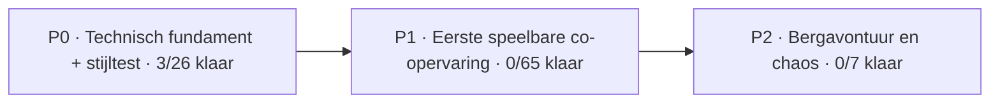

# 🚂 Conductor Chaos — live ontwikkelbord

> **Bron van waarheid:** [GitHub Issues](https://github.com/mlemson/conductor-chaos/issues) en gekoppelde pull requests. Dit is een automatisch gegenereerde momentopname. Wijzig taken in Issues, niet rechtstreeks in dit bestand. Brede epics tellen niet als uitvoertaak.

**Voortgang: 3/98 afgerond (3%)**

| 📝 Te doen | 🔧 Bezig | 👀 Review | ⛔ Geblokkeerd | ✅ Klaar |
| :---: | :---: | :---: | :---: | :---: |
| 69 | 25 | 1 | 0 | 3 |

## 🗺️ Mijlpalen

| Fase | Voortgang | Inhoud |
| :-- | :-- | :-- |
| **P0** | 🟩⬜⬜⬜⬜⬜⬜⬜⬜⬜ 3/26 | Technisch fundament + stijltest |
| **P1** | ⬜⬜⬜⬜⬜⬜⬜⬜⬜⬜ 0/65 | Eerste speelbare co-opervaring |
| **P2** | ⬜⬜⬜⬜⬜⬜⬜⬜⬜⬜ 0/7 | Bergavontuur en chaos |

## 🧩 Overkoepelende onderwerpen (geen uitvoertaken)

Deze brede issues zijn verzamelonderwerpen. Kies een gekoppelde kleine taak; ze tellen niet mee in de voortgang. Zie [de kleine taken](AI/SMALL_TASK_INDEX.md).

| Onderwerp | Fase | Deelissues |
| :-- | :-- | :-- |
| [#5 [P0] Twee spelers in dezelfde bewegende wagon](https://github.com/mlemson/conductor-chaos/issues/5) | P0 | 5 |
| [#6 [P0] Conducteurssleutel en gedeelde treindeur](https://github.com/mlemson/conductor-chaos/issues/6) | P0 | 3 |
| [#7 [P0] Netwerk-koffer oppakken, dragen en loslaten](https://github.com/mlemson/conductor-chaos/issues/7) | P0 | 5 |
| [#28 [P0] Physics-proef: conducteur, trein en grijpen](https://github.com/mlemson/conductor-chaos/issues/28) | P0 | 3 |
| [#10 [P1] Reizigers, tickets en eerste conducteur-taakloop](https://github.com/mlemson/conductor-chaos/issues/10) | P1 | 8 |
| [#11 [P1] Klein station, korte route en eerste incident](https://github.com/mlemson/conductor-chaos/issues/11) | P1 | 2 |
| [#12 [P1] Echte physics-ontsporing van één wagon](https://github.com/mlemson/conductor-chaos/issues/12) | P1 | 3 |
| [#13 [P1] Lobby en schaaltest met 4 tot 6 spelers](https://github.com/mlemson/conductor-chaos/issues/13) | P1 | 3 |
| [#14 [P2] Meerdere wagons koppelen en afzonderlijk laten ontsporen](https://github.com/mlemson/conductor-chaos/issues/14) | P2 | 2 |
| [#15 [P2] Bergtrajecten met bruggen, tunnels en gevaren](https://github.com/mlemson/conductor-chaos/issues/15) | P2 | 5 |
| [#16 [P2] HUD, menu, audio en performance polish](https://github.com/mlemson/conductor-chaos/issues/16) | P2 | 5 |

## 📋 Taken per status

### 📝 Te doen (69)

| Fase | Taak | Onderdeel | Eigenaar | Pull request |
| :-- | :-- | :-- | :-- | :-- |
| P0 | [#2 Valideer Unity-project en URP-import](https://github.com/mlemson/conductor-chaos/issues/2) | Foundation | — | — |
| P0 | [#3 Kies en installeer Netcode, Transport en sessieservices](https://github.com/mlemson/conductor-chaos/issues/3) | Multiplayer | — | — |
| P0 | [#4 Host en afzonderlijke client verbinden](https://github.com/mlemson/conductor-chaos/issues/4) | Multiplayer | — | — |
| P0 | [#8 Multiplayer stressproef voor eerste technische slice](https://github.com/mlemson/conductor-chaos/issues/8) | QA | — | — |
| P0 | [#9 Eerste in-engine artproof: conducteur en wagonhoek](https://github.com/mlemson/conductor-chaos/issues/9) | Art | — | — |
| P0 | [#17 Visueel ontwikkelbord en automatische statusupdates](https://github.com/mlemson/conductor-chaos/issues/17) | Foundation | — | — |
| P0 | [#22 Art proof: locomotief in conceptstijl](https://github.com/mlemson/conductor-chaos/issues/22) | Art | — | — |
| P0 | [#36 Voorkom armclippen, rig benen en herstel loslaten](https://github.com/mlemson/conductor-chaos/issues/36) | Overig | — | — |
| P0 | [#39 UI foundation: menu, HUD en lobbyconcept volgens referenties 1 en 3](https://github.com/mlemson/conductor-chaos/issues/39) | Art | — | — |
| P0 | [#45 Onderhoud: uitvoerbare issue-backlog en zuinige agentworkflow](https://github.com/mlemson/conductor-chaos/issues/45) | Foundation | — | — |
| P0 | [#46 Grip: één los object vanaf de vloer kunnen oppakken](https://github.com/mlemson/conductor-chaos/issues/46) | Physics | — | — |
| P0 | [#48 Grip: twee spelers kunnen niet dezelfde koffer bezitten](https://github.com/mlemson/conductor-chaos/issues/48) | Physics | — | — |
| P0 | [#49 Interacties: één herbruikbare focusdetectie voor props](https://github.com/mlemson/conductor-chaos/issues/49) | Gameplay | — | — |
| P0 | [#54 Spoorroute: korte testbaan uit bestaande railstukken](https://github.com/mlemson/conductor-chaos/issues/54) | Train | — | — |
| P0 | [#55 Treinbeweging: één wagon volgt testspoor](https://github.com/mlemson/conductor-chaos/issues/55) | Train | — | — |
| P0 | [#56 Rijdende wagon: speler blijft op vloer bij rijden/remmen](https://github.com/mlemson/conductor-chaos/issues/56) | Multiplayer | — | — |
| P0 | [#61 Conducteurssleutel: vast voorwerp en slotpunt](https://github.com/mlemson/conductor-chaos/issues/61) | Interactions | — | — |
| P0 | [#62 Treindeur: open/dicht als gedeelde toestand](https://github.com/mlemson/conductor-chaos/issues/62) | Interactions | — | — |
| P0 | [#76 Hoofdmenu: Play en Terug naar de bestaande proefscène](https://github.com/mlemson/conductor-chaos/issues/76) | Polish | — | — |
| P0 | [#99 Verbeter third-personbesturing en armrichting](https://github.com/mlemson/conductor-chaos/issues/99) | Overig | — | — |
| P0 | [#186 Behoud treinsnelheid bij springen en voor passagiers en objecten](https://github.com/mlemson/conductor-chaos/issues/186) | Overig | — | — |
| P1 | [#50 Spelers kunnen elkaar licht fysiek aanstoten](https://github.com/mlemson/conductor-chaos/issues/50) | Physics | — | — |
| P1 | [#51 Speler kan na een val weer opstaan](https://github.com/mlemson/conductor-chaos/issues/51) | Gameplay | — | — |
| P1 | [#52 Prefab voor één testkoffer met collider en massainstellingen](https://github.com/mlemson/conductor-chaos/issues/52) | Gameplay | — | — |
| P1 | [#59 Station: één modulair perron met bank en bord](https://github.com/mlemson/conductor-chaos/issues/59) | World | — | — |
| P1 | [#60 Eerste rit: vertrekstation naar eindhalte](https://github.com/mlemson/conductor-chaos/issues/60) | World | — | — |
| P1 | [#63 Treindeur: openhouden en loslaten tijdens rijden](https://github.com/mlemson/conductor-chaos/issues/63) | Interactions | — | — |
| P1 | [#64 Kolenwagen: toegankelijk laadpunt voor schep](https://github.com/mlemson/conductor-chaos/issues/64) | Gameplay | — | — |
| P1 | [#67 Interacteerbare props hebben één herkenbare feedback](https://github.com/mlemson/conductor-chaos/issues/67) | Interactions | — | — |
| P1 | [#68 NPC: één basis-passagier als herbruikbaar prefab](https://github.com/mlemson/conductor-chaos/issues/68) | Gameplay | — | — |
| P1 | [#69 NPC: passagier kan zitten of staan](https://github.com/mlemson/conductor-chaos/issues/69) | Gameplay | — | — |
| P1 | [#70 NPC: eenvoudige route door één wagon](https://github.com/mlemson/conductor-chaos/issues/70) | Gameplay | — | — |
| P1 | [#71 Tickets: geldig/ongeldig gegeven bij één NPC](https://github.com/mlemson/conductor-chaos/issues/71) | Gameplay | — | — |
| P1 | [#72 Kaartcontrole: één NPC-ticket lezen en aftekenen](https://github.com/mlemson/conductor-chaos/issues/72) | Interactions | — | — |
| P1 | [#73 NPC zegt één korte contextzin bij interactie](https://github.com/mlemson/conductor-chaos/issues/73) | Gameplay | — | — |
| P1 | [#74 NPC: voeten op bank als kleine overtreding](https://github.com/mlemson/conductor-chaos/issues/74) | Gameplay | — | — |
| P1 | [#75 Opdracht: controleer drie passagiers](https://github.com/mlemson/conductor-chaos/issues/75) | Gameplay | — | — |
| P1 | [#77 HUD: één contextuele interactieprompt](https://github.com/mlemson/conductor-chaos/issues/77) | Polish | — | — |
| P1 | [#78 HUD: teller voor actuele opdracht](https://github.com/mlemson/conductor-chaos/issues/78) | Polish | — | — |
| P1 | [#80 UI: knoppen en iconen op één schaal en juiste navigatie](https://github.com/mlemson/conductor-chaos/issues/80) | Polish | — | — |
| P1 | [#81 Geluid: vier eenvoudige feedbackmomenten](https://github.com/mlemson/conductor-chaos/issues/81) | Polish | — | — |
| P1 | [#82 Omgeving: korte houten spoorbrugmodule](https://github.com/mlemson/conductor-chaos/issues/82) | World | — | — |
| P1 | [#83 Omgeving: tunnelportaal als herbruikbaar prefab](https://github.com/mlemson/conductor-chaos/issues/83) | World | — | — |
| P1 | [#84 Dier: één cartoonkoe als speelbaar obstakel](https://github.com/mlemson/conductor-chaos/issues/84) | Art | — | — |
| P1 | [#85 Koe op het spoor: eenvoudige stop/obstakelreactie](https://github.com/mlemson/conductor-chaos/issues/85) | Gameplay | — | — |
| P1 | [#87 Kapotte rail: één herkenbaar beschadigd spoorsegment](https://github.com/mlemson/conductor-chaos/issues/87) | Physics | — | — |
| P1 | [#88 Één wagon kan van spoorgeleiding naar Rigidbody-physics](https://github.com/mlemson/conductor-chaos/issues/88) | Physics | — | — |
| P1 | [#91 Online uitnodigen: eenvoudige joincode of vriendenlink](https://github.com/mlemson/conductor-chaos/issues/91) | Multiplayer | — | — |
| P1 | [#101 Fysiek klimmen en over randen klauteren](https://github.com/mlemson/conductor-chaos/issues/101) | Overig | — | — |
| P1 | [#104 Houd grasplukken en bloemen vrij van mesh colliders](https://github.com/mlemson/conductor-chaos/issues/104) | Overig | — | — |
| P1 | [#120 Achteruit bouwen in Track Builder](https://github.com/mlemson/conductor-chaos/issues/120) | Overig | — | — |
| P1 | [#122 Maak het grijpen van klifranden vergevingsgezinder](https://github.com/mlemson/conductor-chaos/issues/122) | Overig | — | — |
| P1 | [#131 Koppel goedgekeurde UI-sprites aan bestaande Unity-menu's en HUD](https://github.com/mlemson/conductor-chaos/issues/131) | Polish | — | — |
| P1 | [#135 Spoorstukken laten aansluiten op wisselende terreinhoogte](https://github.com/mlemson/conductor-chaos/issues/135) | Overig | — | — |
| P1 | [#142 Treinconfiguratie vindt spoor of locomotief niet duidelijk](https://github.com/mlemson/conductor-chaos/issues/142) | Overig | — | — |
| P1 | [#144 Menu en HUD visueel verbeteren met bestaande iconen](https://github.com/mlemson/conductor-chaos/issues/144) | Overig | — | — |
| P1 | [#172 Plaats drie personages met optilbare ragdoll in treinplayground](https://github.com/mlemson/conductor-chaos/issues/172) | Overig | — | — |
| P1 | [#178 Maak de instaptrede van de regionale wagon dieper](https://github.com/mlemson/conductor-chaos/issues/178) | Overig | — | — |
| P1 | [#180 Voorkom wegtrillende kolen tijdens normaal treinrijden](https://github.com/mlemson/conductor-chaos/issues/180) | Overig | — | — |
| P1 | [#183 Camerazoom en instelbare camerabeweging](https://github.com/mlemson/conductor-chaos/issues/183) | Overig | — | — |
| P1 | [#184 Bukken in physics-playground](https://github.com/mlemson/conductor-chaos/issues/184) | Overig | — | — |
| P1 | [#187 Nieuwe terreindelen met het lichte gras](https://github.com/mlemson/conductor-chaos/issues/187) | Overig | — | — |
| P1 | [#188 Rookdeeltjes met leesbaar mesh in builds](https://github.com/mlemson/conductor-chaos/issues/188) | Overig | — | — |
| P1 | [#189 Voorkom uitgerekte ledematen van passagiers op clients](https://github.com/mlemson/conductor-chaos/issues/189) | Overig | — | — |
| P2 | [#86 Rotsval: één vallende rots als treinincident](https://github.com/mlemson/conductor-chaos/issues/86) | Gameplay | — | — |
| P2 | [#89 Één ontsporing synchroniseren tussen host en client](https://github.com/mlemson/conductor-chaos/issues/89) | Multiplayer | — | — |
| P2 | [#90 Koppeling kan breken bij hoge impact](https://github.com/mlemson/conductor-chaos/issues/90) | Physics | — | — |
| P2 | [#92 Optionele mijlpaalcheck: sessie met vier en later zes spelers](https://github.com/mlemson/conductor-chaos/issues/92) | QA | — | — |
| P2 | [#197 Subtiele zwevende stofdeeltjes in de speelwereld](https://github.com/mlemson/conductor-chaos/issues/197) | Overig | — | — |

### 🔧 Bezig (25)

| Fase | Taak | Onderdeel | Eigenaar | Pull request |
| :-- | :-- | :-- | :-- | :-- |
| P0 | [#47 Grip: object loslaten zonder blijven kleven](https://github.com/mlemson/conductor-chaos/issues/47) | Physics | @mlemson | — |
| P0 | [#53 Spoorasset: recht segment en bocht als Unity-prefabs](https://github.com/mlemson/conductor-chaos/issues/53) | Train | @mlemson | — |
| P1 | [#57 Cabinehendel: eenvoudige bediening van treinsnelheid](https://github.com/mlemson/conductor-chaos/issues/57) | Train | @mlemson | — |
| P1 | [#58 Wagonkoppeling: twee delen visueel koppelen](https://github.com/mlemson/conductor-chaos/issues/58) | Train | @mlemson | — |
| P1 | [#65 Vuurkist: deurtje openen en schep kolen afleveren](https://github.com/mlemson/conductor-chaos/issues/65) | Gameplay | @mlemson | — |
| P1 | [#66 Kolenverbruik: één begrijpelijke keteldruk-/brandstofwaarde](https://github.com/mlemson/conductor-chaos/issues/66) | Gameplay | @mlemson | — |
| P1 | [#79 Lobby: toon echte aangesloten spelers in bestaand menu](https://github.com/mlemson/conductor-chaos/issues/79) | Multiplayer | @mlemson | — |
| P1 | [#115 Houd de third-personcamera buiten de conducteur](https://github.com/mlemson/conductor-chaos/issues/115) | Overig | @mlemson | — |
| P1 | [#151 Locomotiefcabine: vaste bediening en werkende snelheidsmeter](https://github.com/mlemson/conductor-chaos/issues/151) | Overig | @mlemson | — |
| P1 | [#152 Speler raakt soms vast bij spoor of trein](https://github.com/mlemson/conductor-chaos/issues/152) | Overig | @mlemson | — |
| P1 | [#153 Losse handen laten wijken in smalle doorgangen](https://github.com/mlemson/conductor-chaos/issues/153) | Overig | @mlemson | — |
| P1 | [#154 Locomotief: rook en stoomgeluid bij starten](https://github.com/mlemson/conductor-chaos/issues/154) | Overig | @mlemson | — |
| P1 | [#155 Cabine-opstap naar de kolenwagen](https://github.com/mlemson/conductor-chaos/issues/155) | Overig | @mlemson | — |
| P1 | [#156 Armen rekken licht tijdens grijpen](https://github.com/mlemson/conductor-chaos/issues/156) | Overig | @mlemson | — |
| P1 | [#157 Losse wagons langzaam over het spoor duwen](https://github.com/mlemson/conductor-chaos/issues/157) | Overig | @mlemson | — |
| P1 | [#158 Handen zichtbaar houden in cabinecamera](https://github.com/mlemson/conductor-chaos/issues/158) | Overig | @mlemson | — |
| P1 | [#159 Geen extra verbindingsstuk tussen aangekoppelde wagons](https://github.com/mlemson/conductor-chaos/issues/159) | Overig | @mlemson | — |
| P1 | [#160 Trein kan aan het spooreinde de afgrond in rijden](https://github.com/mlemson/conductor-chaos/issues/160) | Overig | @mlemson | — |
| P1 | [#161 Schep soepel hanteren en laten liggen in de trein](https://github.com/mlemson/conductor-chaos/issues/161) | Overig | @mlemson | — |
| P1 | [#162 Schep hoger vasthouden en kolen beter dragen](https://github.com/mlemson/conductor-chaos/issues/162) | Overig | @mlemson | — |
| P1 | [#163 Verlichte startknop met bewuste indruk](https://github.com/mlemson/conductor-chaos/issues/163) | Overig | @mlemson | — |
| P1 | [#170 Art: personagevarianten oudere passagier, toerist en spoormonteur](https://github.com/mlemson/conductor-chaos/issues/170) | Overig | @mlemson | — |
| P1 | [#182 Art: stationsgebouw (begaanbaar) + perronkit en props](https://github.com/mlemson/conductor-chaos/issues/182) | Overig | @mlemson | — |
| P2 | [#149 Herstel preset voor stenen kliffen op hersteltak](https://github.com/mlemson/conductor-chaos/issues/149) | Overig | @mlemson | — |
| P2 | [#164 Verberg playground-HUD na tien seconden](https://github.com/mlemson/conductor-chaos/issues/164) | Overig | @mlemson | — |

### 👀 Klaar voor review (1)

| Fase | Taak | Onderdeel | Eigenaar | Pull request |
| :-- | :-- | :-- | :-- | :-- |
| P1 | [#185 Unstuck: speler terug op de trein](https://github.com/mlemson/conductor-chaos/issues/185) | Overig | — | [#192](https://github.com/mlemson/conductor-chaos/pull/192) |

### ⛔ Geblokkeerd (0)

*Geen taken in deze kolom.*

### ✅ Afgerond (3)

| Fase | Taak | Onderdeel | Eigenaar | Pull request |
| :-- | :-- | :-- | :-- | :-- |
| P0 | [#44 Conducteur valt voorover zodra hij loopt (wrijving romp vs. rechtop-motor)](https://github.com/mlemson/conductor-chaos/issues/44) | Overig | @RZandvoort | — |
| P0 | [#127 Originele UI-referentieafbeeldingen toevoegen aan repository](https://github.com/mlemson/conductor-chaos/issues/127) | Art | — | — |
| P0 | [#129 Losse PNG-sprites voor menu, HUD en iconen importeren](https://github.com/mlemson/conductor-chaos/issues/129) | Art | — | — |

## 🔗 Open pull requests zonder gekoppelde roadmap-taak

Alle open PR's zijn gekoppeld of er zijn geen open PR's.

## 🤝 Samenwerken met mensen en agents

1. Kies of maak een issue en wijs een eigenaar toe zodra het werk begint.
2. Maak een branch en verwijs in de PR-omschrijving naar `Refs #nummer` tijdens ontwikkeling, of `Closes #nummer` als de volledige taak is opgelost.
3. Draft PR = **Bezig**; review-ready PR = **Review**; gesloten issue = **Klaar**. Label `status:blocked` gaat vóór andere open statussen.
4. Het bord wordt automatisch ververst bij issue/PR-events en pushes naar `main` zodra de workflow naar main is gemerged.

**Let op:** één commit of geslaagde build betekent niet dat een hele taak is afgerond.

Zie [samenwerkingsregels](DEVELOPMENT_WORKFLOW.md) en [technische roadmap](ROADMAP.md).
