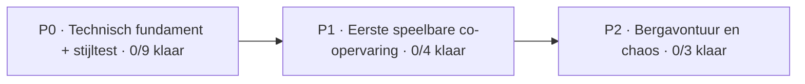

# 🚂 Conductor Chaos — live ontwikkelbord

> **Bron van waarheid:** [GitHub Issues](https://github.com/mlemson/conductor-chaos/issues) en gekoppelde pull requests. Automatisch gegenereerde momentopname; verander taken in Issues.

**Voortgang: 0/16 afgerond (0%)**

| 📝 Te doen | 🔧 Bezig | 👀 Review | ⛔ Geblokkeerd | ✅ Klaar |
| :---: | :---: | :---: | :---: | :---: |
| 15 | 0 | 1 | 0 | 0 |

## 🗺️ Mijlpalen

| Fase | Voortgang | Inhoud |
| :-- | :-- | :-- |
| **P0** | ⬜⬜⬜⬜⬜⬜⬜⬜⬜⬜ 0/9 | Technisch fundament + stijltest |
| **P1** | ⬜⬜⬜⬜⬜⬜⬜⬜⬜⬜ 0/4 | Eerste speelbare co-opervaring |
| **P2** | ⬜⬜⬜⬜⬜⬜⬜⬜⬜⬜ 0/3 | Bergavontuur en chaos |

## 📋 Taken per status

### 📝 Te doen (15)

| Fase | Taak | Onderdeel | Eigenaar | Pull request |
| :-- | :-- | :-- | :-- | :-- |
| P0 | [#2 Valideer Unity-project en URP-import](https://github.com/mlemson/conductor-chaos/issues/2) | Foundation | — | — |
| P0 | [#3 Kies en installeer Netcode, Transport en sessieservices](https://github.com/mlemson/conductor-chaos/issues/3) | Multiplayer | — | — |
| P0 | [#4 Host en afzonderlijke client verbinden](https://github.com/mlemson/conductor-chaos/issues/4) | Multiplayer | — | — |
| P0 | [#5 Twee spelers in dezelfde bewegende wagon](https://github.com/mlemson/conductor-chaos/issues/5) | Train | — | — |
| P0 | [#6 Conducteurssleutel en gedeelde treindeur](https://github.com/mlemson/conductor-chaos/issues/6) | Interactions | — | — |
| P0 | [#7 Netwerk-koffer oppakken, dragen en loslaten](https://github.com/mlemson/conductor-chaos/issues/7) | Physics | — | — |
| P0 | [#8 Multiplayer stressproef voor eerste technische slice](https://github.com/mlemson/conductor-chaos/issues/8) | QA | — | — |
| P0 | [#9 Eerste in-engine artproof: conducteur en wagonhoek](https://github.com/mlemson/conductor-chaos/issues/9) | Art | — | — |
| P1 | [#10 Reizigers, tickets en eerste conducteur-taakloop](https://github.com/mlemson/conductor-chaos/issues/10) | Gameplay | — | — |
| P1 | [#11 Klein station, korte route en eerste incident](https://github.com/mlemson/conductor-chaos/issues/11) | Gameplay | — | — |
| P1 | [#12 Echte physics-ontsporing van één wagon](https://github.com/mlemson/conductor-chaos/issues/12) | Physics | — | — |
| P1 | [#13 Lobby en schaaltest met 4 tot 6 spelers](https://github.com/mlemson/conductor-chaos/issues/13) | Multiplayer | — | — |
| P2 | [#14 Meerdere wagons koppelen en afzonderlijk laten ontsporen](https://github.com/mlemson/conductor-chaos/issues/14) | Physics | — | — |
| P2 | [#15 Bergtrajecten met bruggen, tunnels en gevaren](https://github.com/mlemson/conductor-chaos/issues/15) | World | — | — |
| P2 | [#16 HUD, menu, audio en performance polish](https://github.com/mlemson/conductor-chaos/issues/16) | Polish | — | — |

### 🔧 Bezig (0)

*Geen taken in deze kolom.*

### 👀 Klaar voor review (1)

| Fase | Taak | Onderdeel | Eigenaar | Pull request |
| :-- | :-- | :-- | :-- | :-- |
| P0 | [#17 Visueel ontwikkelbord en automatische statusupdates](https://github.com/mlemson/conductor-chaos/issues/17) | Foundation | — | [#18](https://github.com/mlemson/conductor-chaos/pull/18) |

### ⛔ Geblokkeerd (0)

*Geen taken in deze kolom.*

### ✅ Afgerond (0)

*Geen taken in deze kolom.*

## 🔗 Open pull requests zonder gekoppelde roadmap-taak

Alle open PR's zijn gekoppeld of er zijn geen open PR's.

## 🤝 Samenwerken met mensen en agents

1. Maak of kies een issue en wijs een eigenaar toe zodra werk begint.
2. Open een branch/PR met `Refs #nummer` of `Closes #nummer`.
3. Draft PR = **Bezig**, review-ready PR = **Review**; gesloten issue = **Klaar**.
4. Het dashboard wordt ververst na issue/PR-events en pushes naar `main`, zodra de workflow is gemerged.

**Let op:** een losse commit is geen bewijs dat een taak voltooid is.

Zie [samenwerkingsregels](DEVELOPMENT_WORKFLOW.md) en [technische roadmap](ROADMAP.md).
